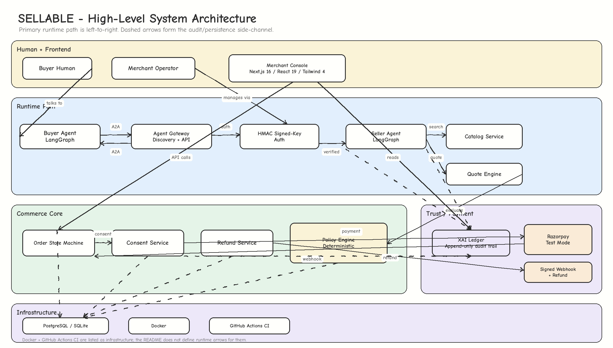
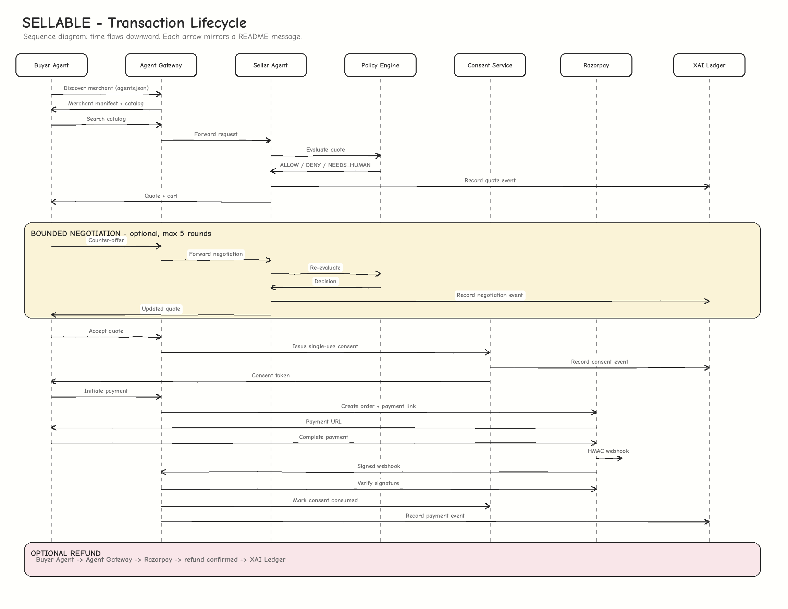
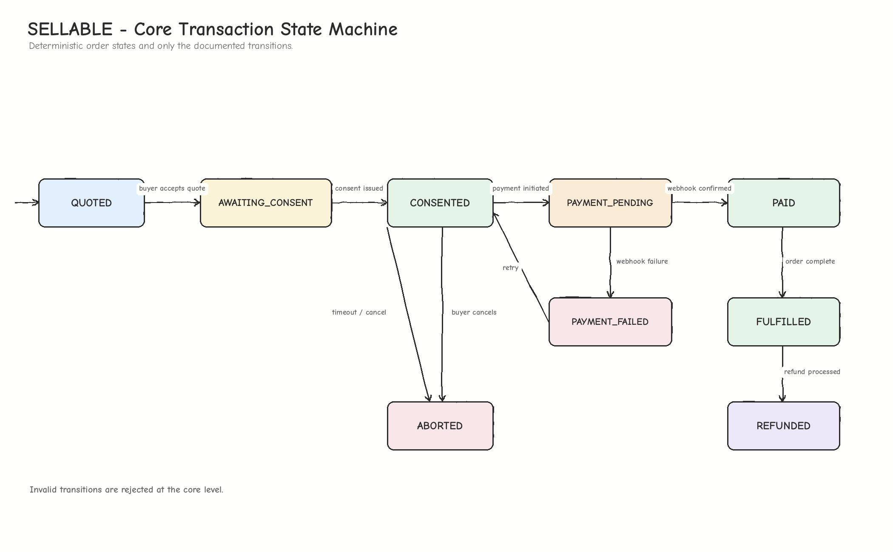
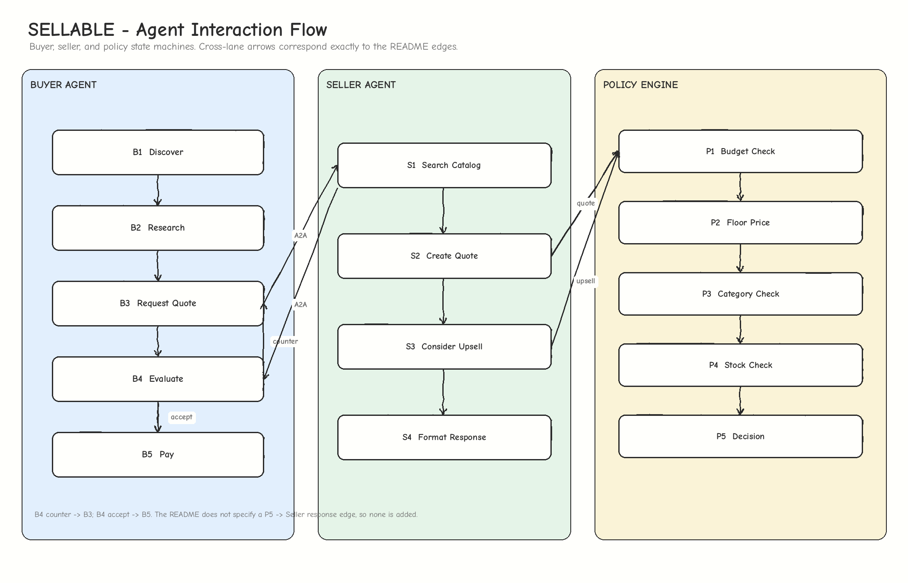
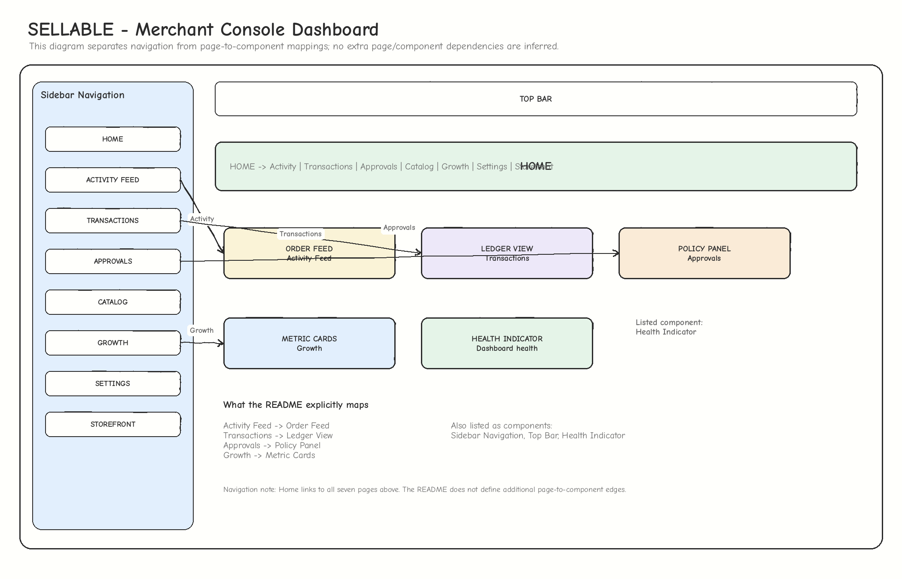

<div align="center">


<br/>

### Agentic Commerce Platform for Merchants

**Your shop gets two agents: a Seller Agent that quotes from your catalog and a Service Agent that looks after orders. Outside shopping agents connect as guests. Policy checks each cart, consent locks each payment, and the ledger records each step.**

<br/>

[](https://github.com/mahirmlk/sellable/actions)
[](https://www.python.org/)
[](https://fastapi.tiangolo.com/)
[](https://langchain-ai.github.io/langgraph/)
[](https://docs.pydantic.dev/)
[](https://www.sqlalchemy.org/)
[](https://nextjs.org/)
[](https://react.dev/)
[](https://www.typescriptlang.org/)
[](https://tailwindcss.com/)
[](https://supabase.com/)
[](https://razorpay.com/)
[](https://www.docker.com/)
[](https://www.sqlite.org/)
[](LICENSE)

<br/>

[Features](#features) | [Architecture](#architecture) | [Quick Start](#quick-start) | [API](#api-reference) | [Docs](#documentation)

</div>

---

## What Is SELLABLE?

**SELLABLE** is an agentic commerce platform for merchants.

Shopping agents already buy on behalf of customers. SELLABLE gives your shop a way to serve them: a Seller Agent that sells from your catalog, a Customer Service Agent that supports your orders, and a gateway where outside shopping agents connect as guests. Underneath sits a deterministic commerce core that owns prices, carts, consent, payments, and the record of what happened.

The model layer proposes. The platform decides. Pricing rules, spend limits, consent, order state, payment verification, and audit logging live outside LLM context, so an agent can hold a conversation without ever holding the till.

> **Agents propose and orchestrate; deterministic services authorize and execute. Every consequential action is observable and auditable.**

---

## How a Sale Moves

One path from first ask to settled order:

```
discovery → search → quote → negotiation → policy check
    → approval (when over your line) → consent → payment
    → webhook settlement → order → support
```

Each step carries a `trace_id`. Each material step emits a ledger event with the actor, the action, the reason, and the policy rules that applied. Open any order in the console to replay its trace line by line.

---

## The Bar We Meet

| Requirement | Implementation |
|---|---|
| **Explainable transactions** | Ledger records every agent action with trace_id, policy refs, and reasoning summaries |
| **Real rails, not mocks** | Razorpay and Stripe test-mode payments, HMAC webhook verification, real refund flow |
| **Consent & guardrails** | Per-transaction single-use consent, spend caps, floor prices, human approval thresholds |
| **End-to-end demo** | Discovery -> negotiation -> consent -> payment -> receipt -> refund, all live |

---

## Features

- **Seller Agent** -- Sells from your catalog: search, recommend, quote, negotiate inside your floor and round limits, suggest linked add-ons, walk buyers to checkout. Bounded by policy, guardrailed, versioned, observed
- **Customer Service Agent** -- Authenticated post-purchase support: order help, shipping status, returns, exchanges, bounded refund asks, human escalation with full context
- **Agent Gateway + Protocols** -- The single machine-facing entry layer. Public discovery (`/.well-known/agents.json`, `/.well-known/ucp`, `llms.txt`, `catalog.ai.json`) and one canonical `/commerce/*` API over REST, MCP, A2A, and UCP, with HMAC signed-key auth, capability negotiation, sessions, delegation, and identity linking
- **Commerce Core** -- Persistent carts, quotes, deterministic pricing and promotions, checkout state machine, orders, GST tax, shipping, returns. All deterministic, all merchant-scoped
- **Policy / Risk / Trust** -- Independent deterministic layers: merchant policy checks, risk and fraud decisions, agent and customer trust signals. The LLM never sees raw risk internals
- **Consent + Payments** -- Single-use, amount-bound, expiring consent tokens. Provider adapters for Razorpay and Stripe (test modes). Only a verified provider webhook can mark an order paid
- **Event Bus + Ledger** -- Async fan-out (analytics, notifications, fulfillment, trust) with retries and dead-letter queue, kept separate from the append-only audit ledger
- **Merchant Console** -- Next.js dashboard: chat checkout, activity ledger, approvals, catalog, buyers, growth, inventory, operations (bus, notifications, analytics, webhooks), evals, connectors, developers, support, settings
- **Reference Shopping Agent** -- A built-in buyer implementation used to exercise your own store end to end and to test gateway behavior. External shopping agents stay outside the platform and connect as gateway clients
- **Evaluation + Sandbox** -- Scenario runner with policy, safety, and regression suites, release gates (P0 suites must hold at 100%), drift monitors, and a stage-gated sandbox with simulated money
- **Connectors + Billing** -- Source-system adapters (custom REST live, Shopify/Woo presets documented), carrier adapters, fail-closed admin surface, usage-metered billing

---

## Architecture

The platform separates into five planes. Agents talk at the top; money moves at the bottom, after policy and consent.



### Transaction Lifecycle



### Core Transaction State Machine



### Agent Interaction Flow



### Merchant Console Dashboard



The authoritative reference is [SELLABLE_ARCHITECTURE.md](SELLABLE_ARCHITECTURE.md).

---

## Quick Start

### Prerequisites

- **Python 3.11+**
- **Node.js 18+** (for Merchant Console)
- **Razorpay test-mode keys** (optional, for payment integration)

### 1. Clone & Install

```bash
git clone https://github.com/mahirmlk/sellable.git
cd sellable

# Backend
python -m venv .venv
source .venv/bin/activate  # or .venv\Scripts\activate on Windows
pip install -e ".[dev]"

# Frontend
cd apps/merchant-console
npm install
cd ../..
```

### 2. Configure Environment

```bash
cp .env.example .env
```

Edit `.env` with your Razorpay test credentials:

```env
SELLABLE_ENVIRONMENT=development
DATABASE_URL=sqlite:///data/sellable.db
RAZORPAY_KEY_ID=rzp_test_...
RAZORPAY_KEY_SECRET=...
RAZORPAY_WEBHOOK_SECRET=...
```

Production defaults are fail-closed. Never copy development overrides to a production host. See [DEPLOYMENT.md](docs/DEPLOYMENT.md).

### 3. Run the Backend

```bash
python -m uvicorn sellable.main:app --reload --host 0.0.0.0 --port 8000
```

### 4. Run the Merchant Console

```bash
cd apps/merchant-console
npm install
npm run dev
```

The console runs at `http://localhost:3000` and connects to the backend at
`http://localhost:8000`. In local demo mode (no `NEXT_PUBLIC_SUPABASE_URL`), the
console authenticates with the public demo key automatically; with Supabase
configured, sign in at `/sign-in` and the dashboard routes are protected.

### 5. Verify

```bash
# Health check
curl http://localhost:8000/health

# Run tests
python -m pytest

# Open Merchant Console
open http://localhost:3000
```

---

## API Reference

The full reference with request shapes lives in [docs/API.md](docs/API.md). The tables below cover the stable surface.

### Discovery

| Endpoint | Method | Description |
|---|---|---|
| `/.well-known/agents.json` | GET | Agent manifest: who you are and what shopping agents may do |
| `/.well-known/ucp` | GET | Full merchant declaration (identity, capabilities, protocols, auth, payments) |
| `/agent/profile` | GET | Platform agents and versions |
| `/agent/capabilities` | GET | Negotiable capability profile |
| `/llms.txt` | GET | Machine-readable merchant description |
| `/catalog.ai.json` | GET | Full product catalog for agents |
| `/a2a/card` | GET | A2A actor card (seller + service) |
| `/mcp/tools` | GET | MCP-compatible tool list (agent key) |

### Agent APIs

| Endpoint | Method | Description |
|---|---|---|
| `/agent/seller/respond` | POST | Seller Agent handles a buyer request (never creates orders or consent here) |
| `/agent/service/respond` | POST | Customer Service Agent: order help, shipping, returns, refunds |
| `/agent/buyer/run` | POST | Run the reference shopping agent end to end (signed-only in production) |
| `/agent/catalog.search` | POST | Search products by query/category |
| `/agent/catalog.get` | POST | Fetch a product by SKU |
| `/agent/quotes.create` | POST | Create a price quote |
| `/agent/quotes.negotiate` | POST | Bounded price negotiation |
| `/agent/consents.request` | POST | Issue transaction-bound, single-use consent |
| `/agent/orders.create` | POST | Create an order (idempotent) |
| `/agent/orders.status` | POST | Query authoritative order state |
| `/agent/refunds.create` | POST | Issue a refund for a paid order |

### Canonical Commerce (`/commerce/*`, all protocols)

| Endpoint | Method | Description |
|---|---|---|
| `/commerce/search` | POST | Service-backed catalog search |
| `/commerce/catalog/lookup` | POST | Product by SKU |
| `/commerce/recommendations` | POST | Deterministic recommendations |
| `/commerce/cart` | POST | Open a persistent, versioned cart |
| `/commerce/cart/items` | POST | Add/set/remove a line (`op`, optimistic concurrency) |
| `/commerce/quotes` | POST | Snapshot a bounded offer from a cart |
| `/commerce/quotes/negotiate` | POST | Propose within floor/round bounds |
| `/commerce/promotions/evaluate` | POST | Eligibility + stacking over cart/checkout |
| `/commerce/checkout` | POST | Lock cart → checkout session |
| `/commerce/checkout/authorize` | POST | Validate → price → risk → authorize |
| `/commerce/orders` | POST | Order from an authorized checkout (idempotent) |
| `/commerce/orders/{id}` | GET | Authoritative order state |
| `/commerce/shipping/quote` | POST | Serviceable options for a pincode |
| `/commerce/returns` | POST | Return case on a settled order |
| `/commerce/refunds/requests` | POST | Merchant-gated refund ask |
| `/commerce/support/cases` | POST | Case-managed support |
| `/commerce/sessions/negotiate` | POST | Capability handshake → session |
| `/commerce/sessions/{id}` | GET | Negotiated session view |
| `/commerce/identity/link` | POST | Open a customer identity link (+ one-time code) |
| `/commerce/identity/link/approve` | POST | Approve by code or merchant approval |
| `/commerce/identity/me` | GET | Resolved linked context |
| `/mcp/call` | POST | Invoke one MCP tool (`tool`, `arguments`) |
| `/a2a/tasks` | POST | Route a task to an agent actor (`actor`, `input`) |
| `/ucp/negotiate` | POST | UCP capability handshake |

All mutating canonical routes accept `X-Session-Id` (negotiated
capabilities) and `X-Delegation-Id` (bounded customer delegation);
`X-Protocol` selects rest/mcp/a2a/ucp attribution.

### Payments

| Endpoint | Method | Description |
|---|---|---|
| `/orders/{id}/payment` | POST | Initiate provider payment (`PAYMENT_PROVIDER`: razorpay/stripe test) |
| `/orders/{id}/payment/retry` | POST | One bounded, idempotent retry after a verified failure |
| `/webhooks/razorpay` | POST | Receive signed Razorpay webhook (drains the event bus) |
| `/webhooks/stripe` | POST | Receive signed Stripe webhook through the same orchestrated boundary (idempotent claims, amount match, strict transitions; 400/404/409 mapping) |
| `/acp/status` | GET | ACP scaffold status (always visible; no placement claims) |
| `/acp/checkout/sessions` | POST | ACP-shaped view of an AUTHORIZED checkout (disabled → 501; read-only) |
| `/webhooks/shipping/{carrier}` | POST | Carrier tracking update (shared-secret authed) |
| `/orders/{id}/refund` | POST | Process refund (merchant auth) |

### Merchant Console

| Endpoint | Method | Description |
|---|---|---|
| `/console/store` | GET | The authenticated merchant's own store record |
| `/console/onboarding` | POST | Create the verified user's own merchant store |
| `/console/onboarding/readiness` | GET | Activation checklist for the store |
| `/console/agent-keys` | GET/POST | List agent API keys / issue a new one (plaintext shown once) |
| `/console/agent-keys/{key_id}/rotate` | POST | Revoke a key and issue a replacement |
| `/console/agent-keys/{key_id}` | DELETE | Revoke an agent API key |
| `/console/transactions` | GET | Transaction list (scoped to the caller's merchant) |
| `/console/transactions/{order_id}` | GET | Transaction detail + full ledger trace |
| `/console/transactions/{order_id}/replay` | GET | Sectioned replay view for an order |
| `/console/catalog` | GET | The merchant's own DB-persisted catalog |
| `/console/catalog/{sku}` | GET | One catalog product by SKU |
| `/console/events` | GET | Ledger events (scoped) |
| `/activity/stream` | GET | SSE live ledger stream (scoped) |
| `/agents/status` | GET | Agent + payment-rail health (summary scoped) |
| `/console/approvals` | GET | Pending approval queue (scoped) |
| `/console/approvals/{id}/approve` | POST | Approve pending action (merchant auth) |
| `/console/approvals/{id}/reject` | POST | Reject pending action (merchant auth) |
| `/console/insights` | GET | Growth metrics (scoped) |
| `/console/policy` | GET/PUT | Read/update the merchant's own policy (`is_default` flags first-run defaults) |
| `/console/onboarding/progress` | GET/PUT | Shared-wizard pointer: resumable `{current_step, completed_steps[], data{}}` (unknown steps → 409) |
| `/console/onboarding/readiness` | GET | Readiness checks + evidence + `live_blockers` |
| `/catalog/products` | POST | Add a product to the merchant's own catalog |
| `/console/agent/seller/respond` | POST | Conversational checkout (merchant JWT) |
| `/console/agent/buyer/run` | POST | Run the reference buyer against your own store (merchant JWT) |
| `/console/buyer-missions` | GET | Recent resumable buyer missions, newest first |
| `/console/buyer-missions/{id}` | GET | One mission's authoritative, re-derived state |
| `/console/buyer-missions/{id}/continue` | POST | Idempotent server-side mission continuation |
| `/console/orders` | POST | Create order via chat checkout (merchant JWT) |
| `/console/orders/{id}/consent` | POST | Issue single-use consent (merchant JWT) |
| `/console/orders/{id}/payment` | POST | Start test-mode payment (merchant JWT) |
| `/console/orders/{id}/payment/retry` | POST | One bounded retry after a verified failure (merchant JWT) |
| `/console/orders/{id}/fulfill` | POST | Mark a paid order fulfilled (merchant auth) |
| `/console/checkout/session` | GET/POST | Restore/persist the durable checkout session |
| `/console/checkout/sessions` | GET | Lightweight chat-history list (scoped) |
| `/console/checkout/session/{id}` | GET/PATCH/DELETE | Open, rename/archive a chat session |
| `/console/orders/{id}/simulate-capture` | POST | Dev-only signed-webhook-boundary capture simulation |
| `/console/orders/{id}/simulate-failure` | POST | Dev-only payment-failure simulation |
| `/console/agent/service/respond` | POST | Customer-service chat (merchant JWT) |
| `/console/notifications` | GET | Merchant notification feed |
| `/console/notifications/{id}/read` | POST | Mark a notification read |
| `/console/analytics/overview` | GET | GMV, conversion, AOV, agent-assisted, promos, refunds |
| `/console/analytics/timeseries` | GET | Daily GMV + order counts |
| `/console/metrics/agents` | GET | Agent run metrics |
| `/console/metrics/commerce` | GET | Commerce metrics |
| `/console/ops/overview` | GET | Bus health, risk/fraud, runs, webhook health |
| `/console/ops/bus/drain` | POST | Drain the merchant's event queue |
| `/console/ops/dead-letters` | GET | Dead-letter queue |
| `/console/ops/dead-letters/{id}/retry` | POST | Requeue for redelivery |
| `/console/webhooks/subscriptions` | GET/POST | List/create signed outbound subscriptions (secret shown once) |
| `/console/webhooks/subscriptions/{id}` | DELETE | Remove a subscription |
| `/console/webhooks/dispatches` | GET | Delivery log with attempt accounting |
| `/console/connectors` | GET/POST | List/register source-system connectors |
| `/console/connectors/{id}` | DELETE | Remove a connector |
| `/console/connectors/{id}/health` | GET | Probe the source system |
| `/console/connectors/{id}/sync` | POST | Pull → normalize → upsert catalog |
| `/console/billing` | GET | Metered usage vs plan quotas |
| `/console/evals/suites` | GET | Versioned suites + latest run status |
| `/console/evals/suites/{id}/run` | POST | Run a suite on an isolated core |
| `/console/evals/runs/{id}` | GET | Per-case results with evidence |
| `/console/evals/drift` | GET | Production-vs-baseline drift report |

---

## Authentication

SELLABLE keeps authentication and authorization strictly separate, with no
mock fallbacks in production:

- **Human merchants** -- Supabase Auth. Access tokens are asymmetric (ES256)
  and are verified locally against the project's JWKS (kid-matched, cached,
  rotation-aware) with the online Auth API as a resilience fallback. After
  verification, the token's `sub` is resolved to the caller's merchant via
  the real `merchant_users` and `merchants` tables. A user with no mapping
  receives an explicit `onboarding_required` (403) state and creates their
  own store through `POST /console/onboarding`. The system never auto-links
  an authenticated user to another store. Every console endpoint is scoped
  to the resolved merchant; foreign order ids are 404s.
- **Shopping agents** -- API key + HMAC request signing. Agent calls authenticate
  with `X-Agent-Key` or an HMAC-SHA256 signature over
  `timestamp.nonce.agent_id.method.path` with `X-Timestamp`, `X-Nonce`, and
  `X-Signature` headers, including server-side replay protection. Two key
  sources are supported: merchant-issued keys (created in the console under
  Storefront → Agent API Keys; only a SHA-256 hash is stored, scoped to the
  issuing merchant) and platform-configured hashes
  (`BUYER_AGENT_API_KEY_HASH`). The well-known demo key is accepted only
  outside production. Env-hash keys serve the demo merchant's records.
- **Database** — application tables (`merchant_users`, `merchants`,
  `catalog_products`, `orders`, `consents`, `ledger_events`, `policy`) have
  RLS enabled and no `anon`/`authenticated` grants; only the backend
  (service role / direct connection) touches them.
- **Deploy matrix (mixed pairing always 401s)** — demo console (no `NEXT_PUBLIC_SUPABASE_URL`) works only
  against a development backend; production rejects the demo key with `auth_not_configured` (401) guidance.
  Otherwise configure the same Supabase project on both sides.
- **Health shape** — dev returns full diagnostics; production returns minimal `{status, database}`.

The model layer is provider-agnostic via `get_llm()` (`agents/llm/`). Changing
`LLM_PROVIDER`/`LLM_MODEL` in `.env` never touches policy, commerce, consent,
payments, the ledger, or the console.

---

## Project Structure

```
sellable/
├── agents/                       # Agent implementations (single canonical tree)
│   ├── seller/                   #   Seller Agent (bounded by policy)
│   ├── customer_service/         #   Customer Service Agent (bounded support)
│   ├── buyer/                    #   Reference shopping agent (tests, console missions)
│   ├── llm/                      #   Provider adapters (OpenAI, Anthropic, mock)
│   └── runtime/                  #   Guardrails, model gateway, versioning, recorder
├── apps/
│   └── merchant-console/         # Next.js 16 merchant console
│       ├── app/                  #   App router pages (landing, console, auth)
│       │   ├── (sign-in|sign-up|forgot-password|reset-password|auth|demo|sign-out)/  # access experience
│       │   └── dashboard/      #   Guarded console (incl. 7-step onboarding wizard)
│       ├── components/           #   React components
│       ├── lib/                  #   API client, types, utils
│       │   ├── demo/           #   Isolated Demo Mode adapter (fixtures + overlay, no network)
│       │   └── onboarding.ts   #   Shared wizard model (prod/demo adapters)
│       ├── middleware.ts       #   Session gate: dashboard by auth state, demo cookie routing
│       └── public/               #   Static assets (logo, favicon)
├── data/                       # SQLite dev database
├── docs/                         # Documentation (see table below)
├── services/commerce/sellable/   # Python backend
│   ├── main.py                   #   FastAPI application (gateway + console + canonical API)
│   ├── core.py                   #   CommerceCore orchestrator
│   ├── contracts.py              #   Pydantic models & enums
│   ├── policy.py                 #   Deterministic policy engine
│   ├── consent.py                #   Single-use consent service
│   ├── gateway.py                #   Delegation enforcement at the boundary
│   ├── auth.py                   #   HMAC signed-key auth
│   ├── merchant_auth.py        #   Supabase merchant sessions (demo-key requires local DB)
│   ├── onboarding.py           #   Lifecycle stages + wizard step registry
│   ├── agents/                   #   Seller, service, and reference buyer orchestration
│   ├── protocols/                #   REST canonical + UCP/MCP/A2A, sessions, identity (+ disabled-by-default ACP scaffold)
│   ├── ledger/                   #   Append-only audit ledger
│   ├── payments/                 #   Razorpay, Stripe, simulated adapters
│   ├── support.py                #   Cases, returns, refunds, exchanges
│   ├── tax.py / shipping.py      #   GST tax, serviceability + estimates
│   ├── event_bus.py              #   Async fan-out with retries + DLQ
│   └── trust.py / risk.py        #   Trust signals, risk/fraud decisions
```

---

## Safety Invariants

These are **non-negotiable**. Every component enforces them:

| Invariant | Enforcement |
|---|---|
| Integer paise only | Pydantic models validate `int` for all money fields |
| No float money | Static analysis + tests reject float amounts |
| `trace_id` everywhere | Every API call and ledger event carries a trace ID |
| Ledger audit trail | Every material action emits a `LedgerEvent` with reasoning |
| Policy independence | Policy engine, consent, orders, payments are isolated from LLM code |
| Webhook authority | Only verified provider webhooks can mark orders as PAID |
| Single-use consent | Consent tokens are consumed on use, never reusable; races are retried once via re-issue |
| HMAC verification | All provider webhooks are signature verified |
| Deterministic state machine | Invalid order transitions are rejected at the core level |

---

## Evaluation

The `evals/` harness exercises the platform before any agent or model version ships:

- **Commerce scenarios** (`evals/scenarios/`) -- happy-path purchase, floor and budget denials, human-approval routing, duplicate consent and webhook idempotency, payment failure, refunds, and hallucinated-SKU grounding
- **Safety battery** (`evals/safety/`) -- adversarial cases: prompt injection, malicious tool arguments, expired delegation, replayed webhooks, cross-tenant access
- **Regression gates** (`evals/regression/`) -- P0 safety and commerce suites must hold at 100%; quality, cost-per-run, and latency gates carry tunable thresholds
- **Drift monitor** (`evals/drift.py`) -- production-vs-baseline comparison over live metrics

```bash
# Run the scenario suite
python -m evals.runner.scenario_runner

# Backend test suite
python -m pytest
```

---

## Documentation

| Document | Description |
|---|---|
| [SELLABLE_ARCHITECTURE.md](SELLABLE_ARCHITECTURE.md) | Target platform architecture (authoritative) |
| [ARCHITECTURE.md](ARCHITECTURE.md) | Retired buildathon slice (pointer + mapping) |
| [ARCHITECTURE_GUIDE.md](docs/ARCHITECTURE_GUIDE.md) | Architecture deep-dive for developers |
| [AGENT_INTEGRATION.md](docs/AGENT_INTEGRATION.md) | External agent integration (auth, delegation, protocols) |
| [CONNECTORS.md](docs/CONNECTORS.md) | Connectors, carriers, and payment providers |
| [API.md](docs/API.md) | Full API reference with examples |
| [DATABASE.md](docs/DATABASE.md) | Database schema & migrations |
| [DATA_MODEL.md](docs/DATA_MODEL.md) | Domain model reference |
| [DEMO.md](docs/DEMO.md) | 5-minute demo walkthrough |
| [DEPLOYMENT.md](docs/DEPLOYMENT.md) | Production deployment guide |
| [LEDGER.md](docs/LEDGER.md) | Ledger documentation |
| [POLICY_ENGINE.md](docs/POLICY_ENGINE.md) | Policy engine deep-dive |
| [TESTING.md](docs/TESTING.md) | Testing strategy & conventions |
| [TROUBLESHOOTING.md](docs/TROUBLESHOOTING.md) | Common issues & fixes |
| [SECURITY.md](SECURITY.md) | Security policy & vulnerability reporting |
| [CHANGELOG.md](CHANGELOG.md) | Version history |

---

## Tech Stack

**Backend**
- Python 3.11+
- FastAPI
- LangGraph
- Pydantic v2
- SQLAlchemy 2.0
- PyJWT (ES256 merchant auth)
- SlowAPI (rate limiting)
- Uvicorn

**Frontend**
- Next.js 16 (App Router)
- React 19
- TypeScript 5
- Tailwind CSS 4
- Lucide Icons
- Geist Font

**Auth & Data**
- Supabase Auth (ES256 JWTs) + `@supabase/ssr` / `supabase-js`
- Supabase Postgres (prod) / SQLite (dev)
- psycopg 3 (PostgreSQL driver)

**Payments**
- Razorpay SDK (test mode) + Stripe HTTPS adapter (test mode)
- HMAC webhook verification (both rails)

**DevOps & Testing**
- Docker + Docker Compose
- GitHub Actions CI
- pytest + httpx
- zrok v2 (tunneling)

---

## Contributing

1. Fork the repository
2. Create a feature branch: `git checkout -b feature/my-feature`
3. Commit with conventional format: `feat: add new feature`
4. Push and open a Pull Request

All PRs must pass CI (Python 3.11/3.12 matrix), maintain test coverage, and follow the existing code conventions.

---

## License

MIT License -- see [LICENSE](LICENSE) for details.

---

<div align="center">

**2026 SELLABLE. Agentic commerce platform for merchants.**

</div>
